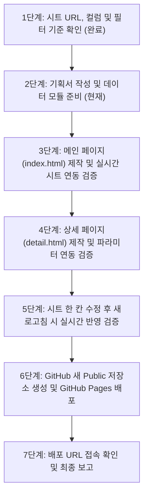

# [작업 기획서] 2026 부산대학교 직무연수 안내 포털

- **문서 버전**: v1.1 (구글 시트 실데이터 연동 반영)
- **작성일자**: 2026-10-23
- **작업 디렉토리**: `C:\Antigravity\Site development\2026-10-23`
- **배포 플랫폼**: GitHub Pages (Static Web Hosting)

---

## 1. 프로젝트 개요 및 메타 정보

- **사이트 공식 명칭**: 2026 부산대학교 직무연수 포털 (PNU Job Training Portal 2026)
- **사이트 소개 문구 (메인 카피)**: 
  > *"미래 교육과 대학 혁신을 선도하는 부산대학교 교직원 역량 강화 플랫폼"*  
  > 국립 부산대학교 교직원의 전문성 향상과 실무 역량 강화를 위해 2026년도 직무연수 32개 전 과정의 일정, 커리큘럼, 신청 정보를 실시간으로 제공합니다.
- **연동 데이터 소스**:
  - 구글 스프레드시트 공유 문서
  - 시트 ID: `1sWeq6LCPTp0I6ith07XQizLm-KcDvAcbeNZBHkOBOvk` (gid: `1980309032`, sheet: `data`)
  - CSV API 엔드포인트: `https://docs.google.com/spreadsheets/d/1sWeq6LCPTp0I6ith07XQizLm-KcDvAcbeNZBHkOBOvk/gviz/tq?tqx=out:csv&sheet=data&headers=1`
  - 파서: **PapaParse** (`papaparse.min.js`)를 사용하여 쉼표 및 개행 문자 안전 파싱
  - 실시간성 보장: 페이지 로드 시 캐시 버스팅 파라미터(`&_t=${Date.now()}`)를 적용하여 시트 수정 즉시 새로고침 시 화면에 반영

---

## 2. 구글 시트 데이터 스키마 (17개 컬럼)

확인된 32개 연수 과정의 실제 컬럼 구성:

| 번호 | 컬럼명 | 설명 | 데이터 예시 |
|:---:|:---|:---|:---|
| 0 | `과정코드` | 고유 식별자 (ID) | `PNU-2026-001`, `PNU-2026-401` |
| 1 | `과정명` | 연수 공식 명칭 | `직장 내 성희롱·성폭력 예방 교육`, `AI 마에스트로` |
| 2 | `분야` | 10개 핵심 직무 카테고리 | 법정의무교육, 정보화·AI·데이터, 직무공통·문서, 예산·회계·계약, 인사·노무, 대학행정 특화, 소통·CS·민원, 리더십·역량, 안전·보건, 어학·글로벌 |
| 3 | `대상` | 수강 대상 교직원 구분 | `전 직원`, `실무자`, `관리자`, `신규자` |
| 4 | `이수구분` | 연수 필수 여부 | `필수`, `필수(해당자)`, `권장`, `선택` |
| 5 | `교육방식` | 교육 형태 | `온라인`, `집합`, `혼합` |
| 6 | `교육시간` | 인정 이수 시간 | `1시간`, `6시간`, `24시간(8주)` |
| 7 | `정원` | 수강 정원 제한 | `무제한`, `30명`, `40명` |
| 8 | `교육기간` | 실제 교육 진행 일시 | `상시(2026-01-02~12-31)`, `2026-03-16~03-17` |
| 9 | `신청기간` | 수강 신청 접수 기간 | `상시`, `2026-03-02~03-11` |
| 10 | `담당부서` | 주관 및 운영 부서 | 인재개발원, 정보화본부, 재무과, 총무과, 입학본부 등 |
| 11 | `한줄소개` | 카드 표시용 요약 문구 | 연수 개요 한 줄 요약 |
| 12 | `상세소개` | 상세 페이지 설명문 | 법적 근거, 연수 배경, 상세 교육 내용 설명 |
| 13 | `학습목표` | 교육 목표 (가운데 점 `·` 구분) | 세부 학습 성과 지표 |
| 14 | `주요내용` | 커리큘럼 항목 (가운데 점 `·` 구분) | 주차별/모듈별 세부 목차 |
| 15 | `신청링크` | 온라인 수강신청 URL | `https://hrd.pusan.ac.kr/course/PNU-2026-XXX` |
| 16 | `문의` | 담당부서 및 전화번호 | 예: `인재개발원 051-510-1231` |

---

## 3. 디자인 시스템 ("frontend-design" 원칙 적용)

### 3.1 비주얼 아이덴티티: Refined Academic Modernism
- **부산대학교 공식 아이덴티티**:
  - `PNU Ocean Blue` (`#003B80`): 헤더, 메인 버튼, 핵심 강조점
  - `PNU Deep Navy` (`#0B1E36`): 본문 텍스트, 푸터, 헤드라인
  - `PNU Accent Gold/Amber` (`#D97706` / `#B45309`): 필수 이수 뱃지, 마감 임박 알림
  - `Surface Light` (`#F8FAFC` / `#FFFFFF`): 배경 및 카드 표면
  - `Border Subtle` (`#E2E8F0`): 정교한 그리드 보더
- **타이포그래피**:
  - `Pretendard` 웹폰트 전면 적용
  - 서수 및 D-Day, 이수 시간 등에는 Tabular Figures(`font-variant-numeric: tabular-nums`) 적용
- **안티 AI-슬롭(Anti-AI Slop)**:
  - 무의미한 보라색 그라데이션 및 카드 과다 섀도우 지양
  - 신뢰감 있는 보더 기반 그리드와 명확한 텍스트 하이어라키

---

## 4. 폴더 및 파일 구조

```
C:\Antigravity\Site development\2026-10-23\
├── PROJECT_PLAN.md               # [완료] 작업 기획서
├── index.html                    # [Step 3] 메인 연수 목록·검색·필터 페이지
├── detail.html                   # [Step 4] 연수 상세·커리큘럼·신청 안내 페이지
├── css/
│   ├── base.css                  # 리셋, 색상 변수, 타이포그래피
│   ├── components.css            # 뱃지, 버튼, 입력창, 헤더, 푸터
│   ├── main.css                  # 메인 페이지 전용 그리드 & 필터
│   └── detail.css                # 상세 페이지 전용 레이아웃 & 사이드바
├── js/
│   ├── api.js                    # PapaParse 기반 Google Sheets 실시간 연동 & Fallback
│   ├── filter.js                 # 실시간 검색 및 다차원 복합 필터 엔진
│   ├── main.js                   # 메인 페이지 렌더링 & URL 쿼리 연동
│   ├── detail.js                 # URL 파라미터(?id=...) 기반 상세 렌더링
│   └── mockData.js               # 오프라인 및 구글 시트 장애 대비 백업 데이터(32개 과정)
└── assets/
    ├── images/                   # 부산대 엠블럼, 심볼 이미지
    └── icons/                    # 직관적인 SVG 아이콘
```

---

## 5. 두 페이지의 구성 요소 및 기능 목록

### 5.1 메인 페이지 (`index.html`)

1. **상단 네비게이션 (Sticky Header)**
   - 부산대학교 엠블럼 및 "2026 직무연수 포털" 브랜딩
   - 구글 시트 실시간 연동 상태 인디케이터 (🟢 실시간 연동됨 / 동기화 시간)
   - 데이터 새로고침 버튼 (클릭 시 캐시 무시하고 즉시 재로드)
2. **히어로 브리핑 섹션 (Hero & Live Metrics)**
   - 메인 타이틀: "2026 부산대학교 직무연수 종합 안내"
   - 실시간 메트릭 카드 4종:
     - 📚 전체 연수 과정 (32개)
     - ⚡ 법정의무/필수 과정 (6+개)
     - 💻 온라인/상시 과정
     - 🏢 집합/실습 과정
3. **통합 검색 및 강조 필터 컨트롤 바**
   - **실시간 검색창**: 연수명, 과정코드, 주요내용, 담당부서 즉시 검색 (디바운스 200ms)
   - **분야별 탭 필터 (가장 강조)**:
     - [전체] [법정의무] [정보화·AI·데이터] [직무공통] [예산·회계] [인사·노무] [대학행정] [소통·CS] [리더십] [안전·보건] [어학]
   - **보조 드롭다운 필터**:
     - 대상별: [전체] [전 직원] [실무자] [관리자] [신규자]
     - 이수구분: [전체] [필수] [권장] [선택]
     - 교육방식: [전체] [온라인] [집합] [혼합]
     - 상태: [전체] [접수중] [상시] [마감]
   - **정렬 옵션**: [과정코드순] [교육시간순] [인기/필수우선순]
   - **활성 필터 태그(Chips)**: 선택된 조건 표시 및 클릭 시 즉시 제거, 전체 초기화 버튼
4. **연수 카드 그리드 (Course Grid)**
   - 카드 레이아웃:
     - 상단: 분야 뱃지 + 이수구분 뱃지 (필수는 골드/오렌지, 권장은 블루)
     - 중앙: 연수 과정명, 한줄소개, 과정코드
     - 하단 스펙: 교육방식 아이콘, 교육시간, 교육기간, 대상, 담당부서
     - 액션: "상세보기 →" 버튼 (클릭 시 `detail.html?id=과정코드` 이동)
   - 스켈레톤 로딩 상태 및 검색 결과 없음(Empty State) 대응
5. **하단 푸터 (Footer)**
   - 부산대학교 대표 주소 및 담당 부서별 대표 내선번호
   - GitHub 배포 정보 및 실시간 시트 동기화 안내

---

### 5.2 상세 페이지 (`detail.html`)

1. **상단 서브 네비게이션**
   - "← 연수 목록으로 돌아가기" (메인의 검색/필터 상태 보존)
   - Breadcrumb: `홈 > 직무연수 > [분야명] > [과정명]`
2. **연수 헤더 (Course Header)**
   - 과정코드 및 분야 뱃지, 필수/권장 구분 뱃지, 교육방식 뱃지
   - 볼드한 과정명 타이틀 및 핵심 한줄소개
3. **핵심 연수 정보 그리드 (6개 주요 스펙 카드)**
   - 📅 **교육기간**: 교육 진행 일정
   - ⏱️ **인정시간**: 이수 인정 시간수
   - 👥 **수강대상 / 정원**: 대상 직급 및 정원(무제한 or N명)
   - 📝 **신청기간**: 접수 시작 및 종료일 (D-Day 자동 계산)
   - 🏛️ **교육방식 / 담당부서**: 온라인/집합 및 주관 부서
   - 📞 **문의처**: 담당자 전화번호 및 바로 통화 연결
4. **상세 콘텐츠 탭 / 섹션**
   - **연수 개요 및 법적 근거**: `상세소개` 전문 렌더링
   - **학습 목표**: `학습목표` 가운데 점 분리하여 체크포인트 리스트 UI로 시각화
   - **주요 커리큘럼**: `주요내용` 단계별 타임라인/모듈 카드 형태로 가공 표시
5. **플로팅 신청 액션바 (Desktop Sticky Sidebar / Mobile Fixed Bottom)**
   - 이수구분 및 남은 접수 일정 안내
   - **"연수 신청하기" 대형 CTA 버튼**: 구글 시트의 `신청링크` 새 창으로 연결
   - 링크 복사(공유) 및 인쇄하기 버튼

---

## 6. 단계별 점진적 실행 및 검증 절차



- [x] **1단계**: 구글 시트 공유 URL, 시트 ID, 컬럼(17개), 32개 과정 데이터 전수 분석 완료
- [x] **2단계**: 작업 기획서(`PROJECT_PLAN.md`) 갱신 및 폴더 구조 확정
- [x] **3단계**: 메인 페이지(`index.html`, CSS, JS) 제작 및 PapaParse 실시간 로드 검증
- [x] **4단계**: 상세 페이지(`detail.html`) 제작 및 과정 상세 렌더링 검증
- [x] **5단계**: 시트 데이터 실시간 반영 테스트 (사용자 신규 수정 데이터 즉시 동기화 검증 통과)
- [x] **6단계**: GitHub Public 저장소 생성 및 코드 Push, GitHub Pages 활성화
- [x] **7단계**: 배포 URL 확인 및 최종 작업 종료

---

## 7. 최종 배포 정보

- **GitHub Public 저장소 주소**: [https://github.com/156jemin/pnu-training-2026](https://github.com/156jemin/pnu-training-2026)
- **GitHub Pages 배포 웹사이트 주소**: [https://156jemin.github.io/pnu-training-2026/](https://156jemin.github.io/pnu-training-2026/)
- **상세 페이지 예시 URL**: [https://156jemin.github.io/pnu-training-2026/detail.html?id=PNU-2026-001](https://156jemin.github.io/pnu-training-2026/detail.html?id=PNU-2026-001)
- **연동 구글 스프레드시트**: [https://docs.google.com/spreadsheets/d/1AnF5bq0evawE9FnfA6QiyEq50rLtkSNR0tgggCkuGBk/edit?gid=0#gid=0](https://docs.google.com/spreadsheets/d/1AnF5bq0evawE9FnfA6QiyEq50rLtkSNR0tgggCkuGBk/edit?gid=0#gid=0)
